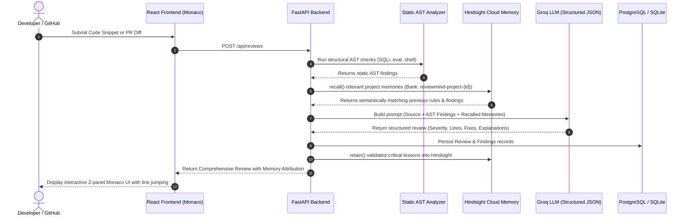

# ReviewMind – AI-Powered Code Review Agent with Persistent Memory

ReviewMind is a full-stack, production-minded AI code review platform built with **FastAPI**, **React**, **Monaco Editor**, **Groq AI**, and **Hindsight by Vectorize**.

Unlike conventional stateless code review tools, ReviewMind features **persistent agent memory**. It remembers previous code reviews, learns project-specific coding standards, recognizes recurring developer mistakes, and provides increasingly tailored and accurate reviews over time.

---

## 1. Architecture Overview

### Review Orchestrator Dataflow


### Separation of Responsibilities
* **PostgreSQL / SQLAlchemy**: Stores transactional application records: users, projects, memberships, review history, audit logs, and encrypted GitHub connections.
* **Hindsight by Vectorize**: Manages agent long-term memory: semantic recall, recurring bug patterns, confirmed standards, and developer preferences across strictly isolated project banks (`reviewmind-project-{id}`).
* **Groq API**: High-speed LLM inference with structured JSON output, guided by system guardrails, static AST findings, and recalled memories.
* **Python AST**: Deterministic static security analysis guaranteeing immediate detection of dangerous patterns (SQL concatenation, `eval()`, `subprocess(shell=True)`, exposed secrets) before LLM generation.

---

## 2. Technology Stack

### Frontend
* **React 19** & **Vite**
* **Tailwind CSS v4** (Crisp minimal light theme default, optional dark mode)
* **Monaco Editor** (`@monaco-editor/react` with Python, JS, TS, Java, C++, SQL syntax highlighting & line jumping)
* **React Router DOM**
* **Axios** (JWT interceptor with automatic bearer token attachment)
* **Lucide React** icons

### Backend
* **Python 3.13** & **FastAPI**
* **Pydantic v2** & **Pydantic-Settings**
* **SQLAlchemy 2.0** ORM
* **Alembic** database migrations
* **Bcrypt** password hashing & **PyJWT** authentication
* **Python AST** static code analyzer (detects SQL concatenation, eval, shell=True, hardcoded credentials)

### AI & Agent Memory
* **Groq API** (`openai/gpt-oss-120b` / `llama-3.3-70b-versatile`, dynamically resolved with model availability inspection)
* **Hindsight by Vectorize** (`hindsight-client` Python SDK with project bank isolation)

---

## 3. Quick Start Guide

### Prerequisites
* Python 3.11+
* Node.js v18+ & npm
* Groq API Key
* Hindsight Cloud Account & API Key (or local Docker Hindsight instance)

---

### Step 1: Backend Setup

```bash
# Navigate to backend directory
cd backend

# Create and activate virtual environment
python -m venv venv

# On Windows (PowerShell):
.\venv\Scripts\Activate.ps1
# On Linux / macOS:
source venv/bin/activate

# Install dependencies
pip install -r requirements.txt

# Configure environment variables
# Ensure your backend/.env contains:
# DATABASE_URL=sqlite:///./reviewmind.db
# JWT_SECRET_KEY=your-secure-random-jwt-key-32chars-min
# GROQ_API_KEY=gsk_...
# GROQ_MODEL=openai/gpt-oss-120b
# HINDSIGHT_BASE_URL=https://api.hindsight.vectorize.io
# HINDSIGHT_API_KEY=your_hindsight_cloud_key
# HINDSIGHT_BANK_ID=reviewmind
# HINDSIGHT_TIMEOUT_SECONDS=60
```

Run database migrations:
```bash
alembic upgrade head
```

Start the FastAPI backend server:
```bash
python -m uvicorn app.main:app --host 127.0.0.1 --port 8000 --reload
```
API Documentation will be live at: `http://localhost:8000/docs`

---

### Step 2: Frontend Setup

Open a new terminal window:
```bash
# Navigate to frontend directory
cd frontend

# Install dependencies
npm install

# Start Vite development server
npm run dev
```
The web application will open at: `http://localhost:3000` (or `http://localhost:5173`)

---

## 4. Persistent Memory Integration with Hindsight

ReviewMind integrates the official `hindsight-client` SDK to ensure the AI agent retains knowledge between reviews:

1. **Before Review (`recall()`)**:
   Query Hindsight for the current project using the submitted code, language, and context. Retrieve matching past conventions, known bug patterns, and developer feedback.
2. **During Review (Groq Context)**:
   Inject recalled memories into the Groq prompt under `RECALLED PERSISTENT PROJECT MEMORIES`. Groq verifies whether the current code repeats known project issues.
3. **After Review (`retain()`)**:
   Automatically store validated critical findings in Hindsight. When a developer provides feedback or edits a rule, retain the lesson with tags and metadata.
4. **Project Isolation**:
   Every project has a strictly segregated memory bank: `reviewmind-project-{project_id}`. Memories never leak across projects.

---

## 5. End-to-End Workflow Verification (The 7-Step Scenario)

ReviewMind includes an automated end-to-end verification script testing the complete persistent memory lifecycle:

```bash
cd backend
.\venv\Scripts\python test_complete_workflow.py
```

### Actual Test Execution Output:
```
======================================================================
REVIEWMIND - COMPLETE PERSISTENT MEMORY REVIEW WORKFLOW VERIFICATION
======================================================================

[Step 0] Created Test User: workflow_99af88@example.com (ID: 5)
[Step 1] Created Project: 'Billing System ec05' (ID: 4)
         Associated Hindsight Memory Bank: 'reviewmind-project-4'

[Step 2] Submitting First Code Snippet (vulnerable to SQL injection)...
--- Submitted Code 1 ---
def fetch_user_balance(user_id):
    query = "SELECT balance FROM user_accounts WHERE id = " + user_id
    cursor = db.cursor()
    cursor.execute(query)
    return cursor.fetchone()
------------------------

[Step 3 & 4] Generating AI Code Review via Review Orchestrator (AST + Groq LLM)...
[SUCCESS] Review #1 Completed!
          Quality Score: 70.0/100
          Total Findings: 2
          Summary: The code contains a critical SQL injection vulnerability due to string concatenation in a database query...
          Finding: [CRITICAL] Line 2: SQL Injection via String Concatenation
                   Why it matters: SQL injection can compromise the entire database, exposing sensitive user balances...
                   Suggested Fix:  Use a parameterized query with placeholders and pass user_id as a parameter...

[Step 5] Checking Hindsight Memory Retention...
         Stored Confirmed Project Rule into Hindsight Bank 'reviewmind-project-4': ID retained
         Waiting 3 seconds for Hindsight Cloud semantic indexing...

[Step 6] Submitting Second Code Snippet with another SQL construction issue...
--- Submitted Code 2 ---
def get_customer_invoices(customer_id):
    # Retrieve customer billing history
    sql = f"SELECT * FROM invoices WHERE customer_id = '{customer_id}' ORDER BY date DESC"
    return db.execute(sql).fetchall()
------------------------

[Step 7] Running Second Review - Recalling Previous Project Knowledge...
[SUCCESS] Review #2 Completed!
          Quality Score: 55.0/100
          Recalled Memories Count: 5
          --> Recalled Memory: 'In the 'Billing System ec05' project, developers must never use string concatenation or f-...'
          --> Recalled Memory: 'In the 'Billing System ec05' project, developers must use parameterized cursor.execute pla...'
          --> Recalled Memory: 'The required fix for SQL injection is to use parameterized queries or an ORM....'

[Step 7 Verification] Findings from Second Review:
          Finding: [CRITICAL] Line 3: SQL Injection via f-string in query
                   Memory References: ['Memory #1', 'Memory #2', 'Memory #3', 'Memory #4', 'Memory #5']
                   Explanation: The SQL statement is built by interpolating the user-supplied customer_id directly into the query string using an f-string...

======================================================================
>>> COMPLETE WORKFLOW TEST PASSED ALL 7 PHASES SUCCESSFULLY! <<<
======================================================================
```

---

## 6. Automated Pytest Test Suite

Execute the full backend test suite:

```bash
cd backend
.\venv\Scripts\python -m pytest tests/ -v
```

### Verified Test Matrix:
* `tests/test_health.py`: Healthcheck & diagnostics endpoints (DB, Groq, Hindsight status).
* `tests/test_ast_analyzer.py`: AST static security detection (SQL injection concatenation & f-string, dangerous `eval()`, `subprocess(shell=True)`, hardcoded secrets, JavaScript innerHTML DOM XSS).
* `tests/test_auth_and_projects.py`: User registration, JWT login, and project CRUD operations.
* `tests/test_reviews.py`: Quick review sandbox and project review with developer feedback submission.
* `tests/test_groq_connection.py`: Live Groq API connection and dynamic model fallback.
* `tests/test_hindsight_cloud_integration.py`: Live Hindsight Cloud connectivity, memory retention, recall verification, and bank cleanup.
* `tests/test_hindsight_workflow_integration.py`:
  1. `test_1_and_3_validated_finding_retained_and_recalled`: Validates recall before review & retain after review.
  2. `test_2_retrieved_memory_included_in_groq_context`: Validates prompt inclusion of recalled knowledge.
  3. `test_4_project_memory_isolation_works`: Validates bank isolation preventing memory leakage between Project A and Project B.
  4. `test_5_hindsight_failures_handled_gracefully`: Validates resilient fallback when Hindsight is unreachable.

---

## 7. API Endpoints Reference

| Method | Endpoint | Description |
|---|---|---|
| `GET` | `/api/health` | Service health status |
| `GET` | `/api/health/diagnostics` | Live diagnostics for DB, Groq LLM, and Hindsight Memory |
| `POST` | `/api/auth/register` | Register new user account |
| `POST` | `/api/auth/login` | Authenticate and obtain JWT access token |
| `GET` | `/api/auth/me` | Fetch authenticated user profile |
| `POST` | `/api/projects` | Create software project with isolated Hindsight bank |
| `GET` | `/api/projects` | List projects accessible to user |
| `GET` | `/api/projects/{id}` | Get project details, coding standards, and bank ID |
| `PUT` | `/api/projects/{id}` | Update project standards and settings |
| `DELETE` | `/api/projects/{id}` | Delete project |
| `POST` | `/api/reviews` | Submit code for full AST + Memory + Groq review |
| `POST` | `/api/reviews/quick` | Sandbox review without project context |
| `GET` | `/api/reviews` | List review history with project & severity filters |
| `GET` | `/api/reviews/{id}` | Get review details, findings, metrics, and recalled memories |
| `POST` | `/api/reviews/{id}/feedback` | Record developer feedback and retain into Hindsight |
| `GET` | `/api/memory/status` | Check Hindsight server connectivity |
| `GET` | `/api/memory/{project_id}` | Retrieve retained memories for a project |
| `POST` | `/api/memory/{project_id}/retain` | Manually teach a rule/convention to Hindsight |
| `POST` | `/api/memory/{project_id}/recall` | Test semantic recall from project memory bank |
| `POST` | `/api/github/connect-token` | Securely store encrypted GitHub token |
| `GET` | `/api/github/status` | Check GitHub connection status |
| `GET` | `/api/github/repositories` | List accessible repositories |
| `GET` | `/api/github/repositories/{owner}/{repo}/pull-requests` | List open PRs |
| `POST` | `/api/github/pull-requests/review` | Analyze PR diff with ReviewMind |
| `POST` | `/api/github/reviews/{id}/publish` | Publish developer-approved review to GitHub |

---

## 8. Security & Privacy Guarantees

1. **No Automatic Code Execution**: Submitted source code is parsed with static AST and LLM reasoning. Code is **never executed** on the backend.
2. **Prompt Injection Shielding**: Source code is strictly demarcated as passive data in system prompts, neutralizing attempted prompt injection attacks embedded inside user code.
3. **Zero Leaked Secrets**:
   * API keys (`GROQ_API_KEY`, `HINDSIGHT_API_KEY`, `JWT_SECRET_KEY`) are kept on the server and excluded from Git via `.gitignore`.
   * Frontend code only accesses clean REST APIs without credentials.
   * Passwords are encrypted with salt using pure `bcrypt`.
   * GitHub personal access tokens are stored encrypted using key-derived cipher streams and never returned in plain text.
4. **Explicit Action Required**: ReviewMind requires explicit developer confirmation before publishing any review comments to GitHub PR threads.
